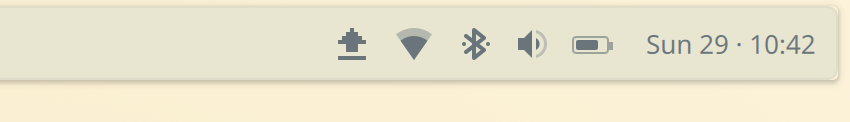
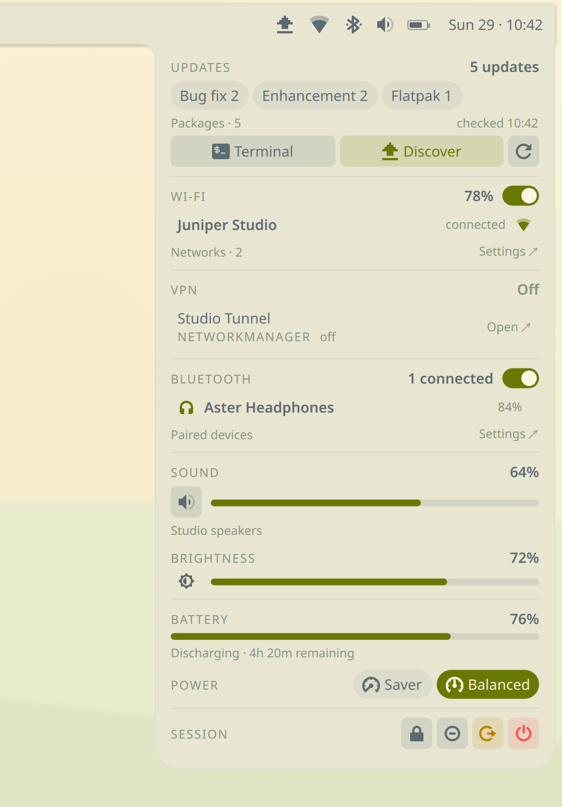

# plasma-statusbar

<picture>
  <source media="(prefers-color-scheme: dark)" srcset="docs/screenshots/panel-dark.png">
  
</picture>

Statusbar (`io.github.aethryl.statusbar`) puts the clock and network, Bluetooth, volume, battery and update indicators in your Plasma 6 panel.

## Inside the notch

- Check Wi-Fi and Bluetooth connections and pending updates.
- Adjust sound and brightness.
- Check battery status, select a power profile and access session actions.

<picture>
  <source media="(prefers-color-scheme: dark)" srcset="docs/screenshots/notch-dark.png">
  
</picture>

*Screenshots show simulated system status.*

## Requirements

- Plasma 6 (tested on 6.7.5)

## Install

```sh
git clone git@github.com:Aethryl/plasma-statusbar.git
cd plasma-statusbar
./install.sh
gdbus call --session -d org.kde.plasmashell -o /PlasmaShell \
  -m org.kde.PlasmaShell.evaluateScript "$(cat add-to-panel.js)"
```

`install.sh` symlinks `plasmoid/` into `~/.local/share/plasma/plasmoids/`, so edits are live. After a QML change, run `systemctl --user restart plasma-plasmashell`.

### Pair with the KDE system tray

Place Statusbar just to the left of KDE's system tray. Keep app icons in the tray and disable its network, volume, battery, Bluetooth and brightness items to avoid duplicate indicators.

## Licences

The code is MIT, see `LICENSE`.

`plasmoid/contents/images/nordzy/` holds Wi-Fi icons from the [Nordzy icon theme](https://github.com/MolassesLover/Nordzy-icon), GPL-3.0. Its licence text sits next to them in `COPYING`; the icons are not covered by the MIT licence.
